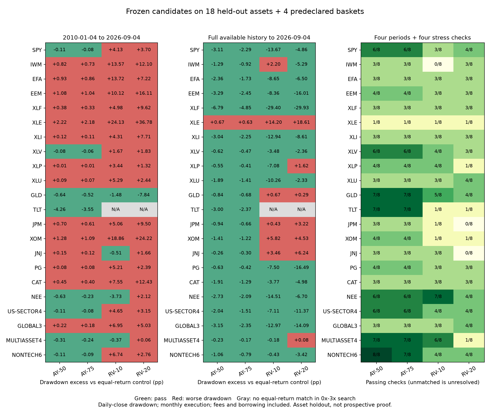

# 固定候选的外部标的验证

保留 AY-50、AY-75、RV-10、RV-20 四个研究候选，参数和第二轮执行器没有修改。新增 18 个此前未用于候选构造的单标的、4 个预先指定组合，完成 2,544 项等收益回撤比较。**本轮仍没有通过全部检查的通用策略。** 保留研究定义不等于恢复已被淘汰的通用资格。

主区间：2010-01-04—2026-09-04；下载数据实际截止 2026-10-07。

## 1. 总结果

| 候选 | 主区间 | 完整历史 | 四区间合计 | 费用／延迟压力 | 五年起点 | 未匹配：区间／五年 |
|---|---|---|---|---|---|---|
| AY-50 | 8/22 | 21/22 | 38/88 | 59/88 | 146/460 | 0/4 |
| AY-75 | 8/22 | 21/22 | 37/88 | 59/88 | 136/460 | 0/3 |
| RV-10 | 4/22 | 15/22 | 30/88 | 38/88 | 196/460 | 2/33 |
| RV-20 | 1/22 | 14/22 | 28/88 | 29/88 | 167/460 | 2/59 |

“通过”严格沿用用户规则：找到最终净收益相同的固定杠杆路径，策略最大回撤不得更大。分母包含未匹配情况；未匹配记为未解决，不记为回撤失败。各标的、相邻五年窗口有相关性，这些比例不是独立试验的成功概率，也没有统计显著性含义。没有根据本轮结果调整任何参数、删除失败标的或选择通过率门槛。

## 2. 应当保留什么

- **AY-50：优先继续研究。** 完整历史通过 21/22，唯一失败为 XLE；但主区间只有 8/22，五年起点只有 146/460。长历史表面优势对入场时点敏感，不能用完整历史覆盖短窗口失败。
- **AY-75：作为同机制的敞口对照保留。** 没有任何单标的／组合通过全部八个区间与压力检查；更高参与率没有消除路径依赖。
- **RV-10：保留低优先级研究实例。** 主区间 4/22，此前科技三股组合优势未广泛迁移。GLD、NEE、JNJ、MULTIASSET4 在主区间通过，但不因此重新定义适用资产池。
- **RV-20：保留原始定义及失败记录，降低研究优先级。** 主区间只有 GLD 通过；能源上大幅劣于等收益对照。不能把较高目标波动当成稳健增强收益的方法。

只有 **AY-50 / NONTECH6** 通过四区间和四压力共 8/8 检查。NONTECH6 是下载前指定的 JPM、XOM、JNJ、PG、CAT、NEE 初始等资金固定份额组合。该组合五年起点仅通过 **12/22**；2014—2019 回撤优势约 **0.002 个百分点**，非常薄，不能视为可靠经济优势。

| 检查 | 年化收益 | 策略回撤 | 等收益对照回撤 | 回撤优势（百分点） |
|---|---|---|---|---|
| primary | 7.16% | 16.90% | 17.01% | 0.1132 |
| full_history | 6.62% | 18.75% | 19.81% | 1.0596 |
| validation_2014_2019 | 6.48% | 7.93% | 7.93% | 0.0018 |
| late_2020_onward | 8.47% | 17.35% | 17.46% | 0.1077 |
| primary/cost_20bp | 7.15% | 16.90% | 17.04% | 0.1408 |
| primary/extra_session_delay | 7.16% | 16.90% | 17.00% | 0.1083 |
| full_history/cost_20bp | 6.62% | 18.77% | 19.87% | 1.1029 |
| full_history/extra_session_delay | 6.62% | 18.75% | 19.81% | 1.0599 |

数学机制也解释了局限：AY 只随新的价格峰值减少单位数、把所得保留为现金。长期上涨中它改变回撤时的敞口路径，但在旧峰值以内反复震荡时没有持续买回、卖出的获利循环。RV 的风险估计有滞后，突跌发生前无法提前降低仓位，价格恢复时也可能仍保持低仓位。因此这些结果并未实现“任意震荡市场也持续盈利”的目标。

## 3. 主区间的完整比较

每格依次为策略年化净收益、策略最大回撤的正幅度、等收益固定杠杆最大回撤的正幅度。最终累计收益和匹配杠杆值均在 all-comparisons.csv 中；同一期间匹配累计收益也匹配年化收益。

| 标的／组合 | AY-50 年化／回撤／对照回撤 | AY-75 年化／回撤／对照回撤 | RV-10 年化／回撤／对照回撤 | RV-20 年化／回撤／对照回撤 |
|---|---|---|---|---|
| SPY | 6.89% / 16.89% / 17.00% | 10.50% / 25.31% / 25.39% | 8.17% / 24.14% / 20.01% | 12.56% / 33.72% / 30.02% |
| IWM | 5.44% / 20.55% / 19.72% | 8.27% / 30.83% / 30.10% | 4.29% / 29.09% / 15.51% | 8.07% / 41.47% / 29.36% |
| EFA | 3.50% / 17.13% / 16.20% | 5.30% / 25.67% / 24.81% | 3.34% / 29.19% / 15.47% | 5.74% / 34.19% / 26.97% |
| EEM | 2.54% / 19.94% / 18.86% | 3.83% / 29.88% / 28.84% | 2.05% / 25.30% / 15.17% | 3.19% / 39.95% / 23.84% |
| XLF | 5.84% / 21.39% / 21.01% | 8.87% / 32.10% / 31.77% | 5.91% / 26.23% / 21.25% | 9.28% / 42.86% / 33.24% |
| XLE | 4.10% / 35.58% / 33.35% | 6.19% / 53.38% / 51.20% | 2.49% / 44.26% / 20.13% | 3.97% / 69.06% / 32.28% |
| XLI | 6.64% / 21.16% / 21.04% | 10.10% / 31.74% / 31.63% | 6.94% / 26.30% / 21.99% | 11.10% / 42.33% / 34.63% |
| XLV | 6.12% / 14.21% / 14.29% | 9.30% / 21.30% / 21.36% | 8.08% / 20.36% / 18.68% | 11.72% / 28.40% / 26.58% |
| XLP | 4.94% / 12.27% / 12.26% | 7.49% / 18.40% / 18.38% | 7.27% / 21.28% / 17.84% | 9.54% / 24.51% / 23.19% |
| XLU | 4.86% / 18.07% / 17.98% | 7.37% / 27.07% / 27.00% | 6.09% / 27.70% / 22.41% | 9.24% / 36.07% / 33.63% |
| GLD | 4.04% / 22.84% / 23.49% | 6.09% / 34.18% / 34.70% | 5.92% / 32.30% / 33.79% | 8.36% / 45.51% / 53.35% |
| TLT | 1.46% / 24.07% / 28.33% | 2.03% / 36.15% / 39.70% | 2.63% / 31.14% / 未匹配 | 2.46% / 48.14% / 未匹配 |
| JPM | 8.04% / 21.75% / 21.05% | 12.27% / 32.65% / 32.04% | 6.67% / 22.55% / 17.50% | 12.12% / 41.15% / 31.65% |
| XOM | 4.52% / 31.16% / 29.88% | 6.83% / 46.76% / 45.67% | 2.98% / 38.47% / 19.62% | 5.34% / 59.67% / 35.45% |
| JNJ | 5.99% / 13.74% / 13.58% | 9.10% / 20.56% / 20.44% | 7.60% / 16.64% / 17.15% | 11.53% / 27.37% / 25.71% |
| PG | 4.18% / 12.76% / 12.67% | 6.33% / 19.12% / 19.04% | 4.81% / 19.75% / 14.54% | 7.69% / 25.46% / 23.07% |
| CAT | 9.73% / 22.32% / 21.87% | 14.82% / 33.46% / 33.06% | 6.96% / 23.30% / 15.75% | 13.03% / 41.55% / 29.12% |
| NEE | 7.26% / 22.44% / 23.07% | 11.06% / 33.69% / 33.92% | 8.39% / 22.64% / 26.37% | 13.04% / 41.69% / 39.56% |
| US-SECTOR4 | 5.34% / 17.17% / 17.28% | 8.10% / 25.76% / 25.84% | 6.87% / 26.71% / 22.06% | 9.88% / 34.37% / 31.22% |
| GLOBAL3 | 4.87% / 16.56% / 16.34% | 7.40% / 24.84% / 24.66% | 5.27% / 24.59% / 17.64% | 8.44% / 33.12% / 28.09% |
| MULTIASSET4 | 4.54% / 12.25% / 12.56% | 6.88% / 18.38% / 18.61% | 7.71% / 20.33% / 20.70% | 9.24% / 24.52% / 24.46% |
| NONTECH6 | 7.16% / 16.90% / 17.01% | 10.90% / 25.34% / 25.42% | 8.91% / 27.73% / 20.99% | 13.48% / 33.79% / 31.03% |

例如 XLE / RV-20 年化收益约 **3.97%**，最大回撤 **69.06%**；达到相同最终收益的约 **0.3759x** 对照回撤仅 **32.28%**，明确淘汰其在此标的上的资格。

TLT 的 RV 两个实例在主区间及完整历史未找到等收益对照。主区间年化分别约 2.630%、2.457%，已扫描的有效 0x—3x 固定杠杆路径最高约 2.428%。这属于对照匹配范围内未解决的案例，不应直接说策略回撤更差或宣布通过；网格最大值也不是连续杠杆最优化的证明。其他已有明确失败的标的仍足以否定通用资格。

## 4. 防止回测结果反向决定策略

候选、18 个单标的和 4 个组合于 **2026-10-08T19:24:49.740485+00:00** 冻结后才开始下载；frozen.json 保存协议、参数、执行器与对照的 SHA-256。未沿用或优化任何已有资产的最优参数；没有修改生产策略。

固定候选的可执行规格位于 retained-candidates.json：

- AY：初始风险资产权重 α=0.50 或 0.75；初始单位 q₀，在月初按昨日已知峰值 M 执行 q=min(当前 q, q₀·(M/P₀)^(α−1))。销售收入留在现金。
- RV：日对数收益平方的指数平均 v，半衰期 63 个交易日，λ=2^(−1/63)，v←λv+(1−λ)r²；月初风险资产权重 w=min(1,目标波动/√(252v))。目标为 10% 或 20%，初始年化风险估计 20%。

各区间分别重新初始化，四区间为主区间、各标的完整可用历史、2014—2019、2020—主截止日。压力检查在主区间和完整历史分别使用 20bp 费用及额外一天信号延迟。五年检查为 2000—2021 各年一月入场、拥有完整五年资料的全部窗口，共 460 个窗口／候选。

这是**资产留出验证**。SPY 和原科技资产重叠，其他资产也有共同宏观风险；现存 ETF 和大型股票有选择及幸存者偏差，不能声称独立、无偏的全市场样本外验证。现有长历史还包含大量早已发生的行情。

另从主区间账户状态连续运行 2026-09-08—2026-10-07，共 22 个交易日，保存 time-extension.json。该段发生于规则冻结之前，是此前未使用的历史时间延伸，**不是规则冻结后的真正前瞻样本**；期间不重置账户、对照沿用主区间匹配杠杆，不用新段结果重新匹配。

## 5. 数据与统一记账

18 个标的合计 **163,374** 条有效日线。原始 Yahoo chart JSON、分红拆股事件、获取时间、来源 URL、哈希全部留存。价格数据截至 2026-10-07，18 个标的均取得有效资料，没有因策略失败删除任何数据。

| 标的 | 有效日线数 | 最早日期 | 截止日期 |
|---|---|---|---|
| SPY | 8480 | 1993-01-29 | 2026-10-07 |
| IWM | 6630 | 2000-05-26 | 2026-10-07 |
| EFA | 6315 | 2001-08-27 | 2026-10-07 |
| EEM | 5909 | 2003-04-14 | 2026-10-07 |
| XLF | 6990 | 1998-12-22 | 2026-10-07 |
| XLE | 6990 | 1998-12-22 | 2026-10-07 |
| XLI | 6990 | 1998-12-22 | 2026-10-07 |
| XLV | 6990 | 1998-12-22 | 2026-10-07 |
| XLP | 6990 | 1998-12-22 | 2026-10-07 |
| XLU | 6990 | 1998-12-22 | 2026-10-07 |
| GLD | 5505 | 2004-11-18 | 2026-10-07 |
| TLT | 6087 | 2002-07-30 | 2026-10-07 |
| JPM | 11735 | 1980-03-17 | 2026-10-07 |
| XOM | 14313 | 1970-01-02 | 2026-10-07 |
| JNJ | 14313 | 1970-01-02 | 2026-10-07 |
| PG | 14313 | 1970-01-02 | 2026-10-07 |
| CAT | 14313 | 1970-01-02 | 2026-10-07 |
| NEE | 13521 | 1973-02-21 | 2026-10-07 |

ETF 范围可查发行方：[SPDR 行业基金](https://www.ssga.com/us/en/individual/capabilities/equities/sector-investing/select-sector-etfs)、[iShares 基金目录](https://www.ishares.com/us/products/etf-investments)、[GLD](https://www.spdrgoldshares.com/usa/gld/)、[TLT](https://www.ishares.com/us/products/239454/TLT)。历史报价来自 Yahoo，发行方链接用于核对资产身份，不作为行情来源。

调整开高低价统一乘以 adjusted close / raw close，避免开盘与收盘复权口径混用；分红再投资包含在调整价格指数中，不二次派发。缺失、重复、非正价格和 OHLC 关系均检查；组合只对齐真实共同交易日，不填造价格。额外下载 QQQ 仅用于旧缓存口径复核，不计入新标的：6,916 个重叠日期的最大日收益差约 1.89×10⁻⁶。

组合均为入场时等资金、以后固定份额的价格指数：US-SECTOR4=XLF/XLE/XLV/XLP；GLOBAL3=SPY/EFA/EEM；MULTIASSET4=SPY/EFA/GLD/TLT；NONTECH6=JPM/XOM/JNJ/PG/CAT/NEE。策略管理整个指数的单位数，没有暗中进行成分等权再平衡。

统一初始资金 10,000，月初可用开盘成交，昨日收盘产生信号，单边比例费用 5bp；策略不借款、不做空，现金收益与税为零。对照按月复位固定风险资产杠杆，1x 与买入持有一致，低于 1x 余款为零利息现金，高于 1x 借款按年率 5.3% ACT/365 计息。0x—3x 扫描后求根，多个可偿付解使用最低杠杆解；对照终值匹配最大相对误差 **1.35e-14**。

回撤按日收盘净值计算，初始本金计入历史峰值；没有日内路径、税务、真实买卖点差、保证金强平或现金利息建模。使用可分割的复权价格指数份额，属于可比研究记账模型，不是完整经纪账户模拟。

资金守恒最大误差 7.09e-10；验证 1x 对照等于买入持有、88 条时间前缀一致、88 条当天收盘变化不影响当天交易状态。verification.json 保存完整检查与哈希。

## 6. 文件与复现

- [冻结规则](protocol.json)、[候选定义](retained-candidates.json)、[冻结哈希](frozen.json)、[资格清单](research-status.json)。
- [复权日线](prices.json)、[数据审计与全部来源](data-audit.json)、raw/ 原始响应。
- [全部比较表](all-comparisons.csv)：2,544 条，保留失败和未匹配；[主要与压力结果](results.json)、[全部五年窗口](cohorts.json)。
- [日净值及仓位](daily-primary.csv.gz)、[连续时间延伸](time-extension.json)、[实现检查](verification.json)。
- 本机运行 reproduce.ps1，优先重用已保存的原始响应，重新生成规范数据、回测及报告。冻结文件发生变化即报错；依赖 Python/numpy/matplotlib，本机运行路径写于脚本。

下一步研究应围绕机制解释和事先固定的新测试规则；本轮外部数据已被查看，不能再用其挑参数后宣称同一批数据是未见样本。
